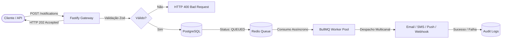

# Notification & Dispatch Event-Driven Engine

> Motor de ingestão e despacho em lote de notificações orientado a eventos, desenvolvido com Node.js, TypeScript (Strict Mode), Fastify, Prisma ORM, PostgreSQL, Redis e BullMQ.

[](https://nodejs.org)
[](https://www.typescriptlang.org)
[](https://fastify.dev)
[](https://www.prisma.io)
[](https://www.postgresql.org)
[](https://redis.io)
[](https://bullmq.io)
[](https://vitest.dev)

---

## 📌 Visão Geral da Arquitetura

O **Notification & Dispatch Event-Driven Engine** foi projetado para cenários de alta volumetria e baixa latência de resposta na ingestão de eventos. O sistema adota o padrão de desacoplamento assíncrono:

1. **Ingestão Rápida (HTTP 202 Accepted):** As requisições de notificação (individual ou em lotes de até 500 itens) são validadas estritamente via **Zod**, salvas no banco com status `QUEUED` e despachadas para o **BullMQ (Redis)**.
2. **Processamento em Background:** Workers dedicados consomem os jobs com concorrência ajustável, priorização (`CRITICAL`, `HIGH`, `NORMAL`, `LOW`), suporte a agendamento (`scheduledAt`) e retentativas exponenciais automáticas (`exponential backoff`).
3. **Auditoria de Ciclo de Vida:** Cada transição de estado (`PENDING` -> `QUEUED` -> `PROCESSING` -> `DELIVERED` / `FAILED`) é registrada na tabela `notification_audit_logs`.
4. **Observabilidade & Health Check:** Endpoint estruturado `/health` reportando conectividade ativa com PostgreSQL, Redis, volumetria da fila e métricas do Node.js.



---

## 🚀 Tecnologias Utilizadas

- **Runtime:** [Node.js](https://nodejs.org) (v22+)
- **Linguagem:** [TypeScript](https://www.typescriptlang.org) (Strict mode ativado)
- **Framework Web:** [Fastify](https://fastify.dev) + `@fastify/rate-limit` + `@fastify/helmet` + `@fastify/cors`
- **Validação de Esquemas:** [Zod](https://zod.dev) integrado com `fastify-type-provider-zod`
- **Banco de Dados & ORM:** [PostgreSQL](https://www.postgresql.org) e [Prisma ORM](https://www.prisma.io)
- **Fila & Cache:** [Redis](https://redis.io) e [BullMQ](https://bullmq.io)
- **Testes Unitários e Integração:** [Vitest](https://vitest.dev) com cobertura v8
- **Documentação de API:** Swagger / OpenAPI via `@fastify/swagger` e `@fastify/swagger-ui`
- **CI/CD:** GitHub Actions com validação de build, linter e testes automatizados

---

## 🛠️ Instalação e Execução

### Pré-requisitos
- Node.js 22+
- Docker e Docker Compose

### 1. Clonar o Repositório e Instalar Dependências
```bash
git clone https://github.com/ViktorGabriel/event-driven-api.git
cd event-driven-api
npm install
```

### 2. Configurar Variáveis de Ambiente
Copie o arquivo de exemplo:
```bash
cp .env.example .env
```

### 3. Subir Serviços Auxiliares (PostgreSQL & Redis)
```bash
docker-compose up -d
```

### 4. Executar Migrações do Banco de Dados
```bash
npm run prisma:generate
npm run prisma:migrate
```

### 5. Iniciar o Servidor em Modo Desenvolvimento
```bash
npm run dev
```
O servidor estará disponível em: `http://localhost:3333`
Documentação OpenAPI / Swagger UI: `http://localhost:3333/docs`

---

## 📡 Endpoints da API

### 1. Ingestão de Notificação Individual
- **Rota:** `POST /api/v1/notifications`
- **Status de Sucesso:** `202 Accepted`

```json
{
  "channel": "EMAIL",
  "recipient": "usuario@exemplo.com",
  "subject": "Confirmação de Pagamento",
  "content": "Seu pedido #98765 foi aprovado.",
  "priority": "HIGH",
  "metadata": {
    "orderId": 98765,
    "total": 299.90
  }
}
```

### 2. Despacho em Lote (Bulk Dispatch)
- **Rota:** `POST /api/v1/notifications/bulk`
- **Status de Sucesso:** `202 Accepted`
- **Limite por requisição:** 500 itens

```json
{
  "notifications": [
    {
      "channel": "EMAIL",
      "recipient": "cliente1@exemplo.com",
      "content": "Aviso de promoção relâmpago",
      "priority": "NORMAL"
    },
    {
      "channel": "SMS",
      "recipient": "+5511999998888",
      "content": "Código de segurança: 492019",
      "priority": "CRITICAL"
    }
  ]
}
```

### 3. Consulta Paginada com Filtros
- **Rota:** `GET /api/v1/notifications?channel=EMAIL&status=DELIVERED&limit=20&page=1`
- **Status:** `200 OK`

### 4. Detalhes de Notificação e Trilha de Auditoria
- **Rota:** `GET /api/v1/notifications/:id`
- **Status:** `200 OK`

### 5. Status do Lote (Batch Status)
- **Rota:** `GET /api/v1/notifications/batch/:batchId`
- **Status:** `200 OK`

### 6. Health Check Estruturado
- **Rota:** `GET /health`
- **Status:** `200 OK` (ou `503 Service Unavailable` em falha de conexão)

```json
{
  "status": "healthy",
  "timestamp": "2026-11-06T18:10:00.000Z",
  "latencyMs": 4,
  "uptimeSeconds": 120,
  "services": {
    "database": "up",
    "redis": "up"
  },
  "queue": {
    "name": "notification-dispatch",
    "metrics": {
      "waiting": 0,
      "active": 0,
      "completed": 150,
      "failed": 0
    }
  },
  "system": {
    "nodeVersion": "v22.x",
    "memoryUsageMb": 42
  }
}
```

---

## 🧪 Suíte de Testes

O projeto conta com 100% dos testes unitários e de integração aprovados:

```bash
# Executar todos os testes
npm run test

# Executar testes com relatório de cobertura
npm run test:coverage

# Executar linter e checagem de formatação
npm run lint
npm run format:check
```

---

## 📄 Licença

Distribuído sob a licença [MIT](LICENSE). Desenvolvido por [Viktor Gabriel](https://github.com/ViktorGabriel).
